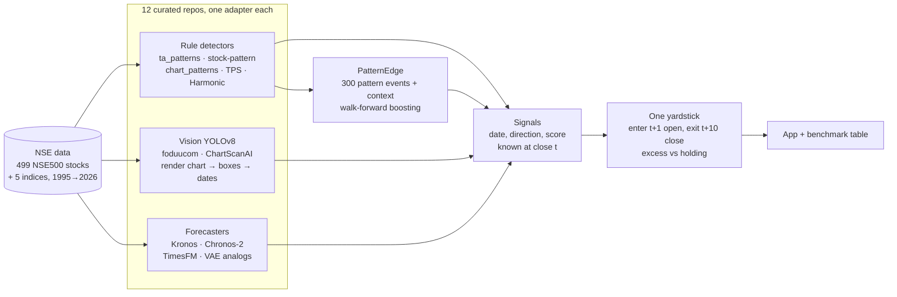
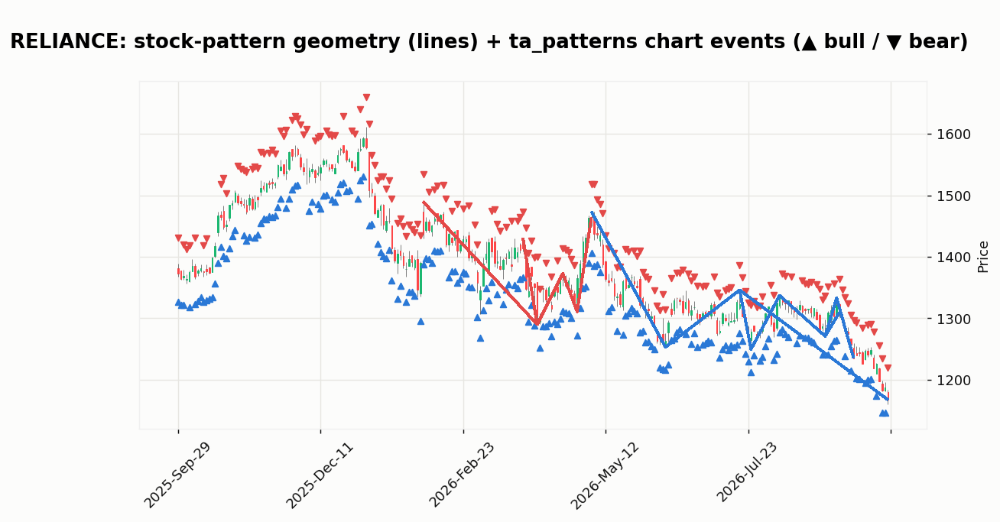
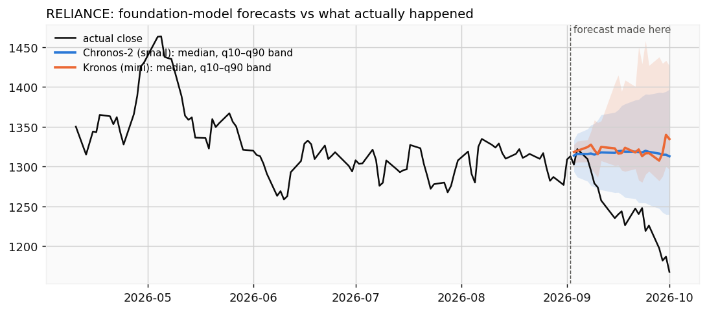
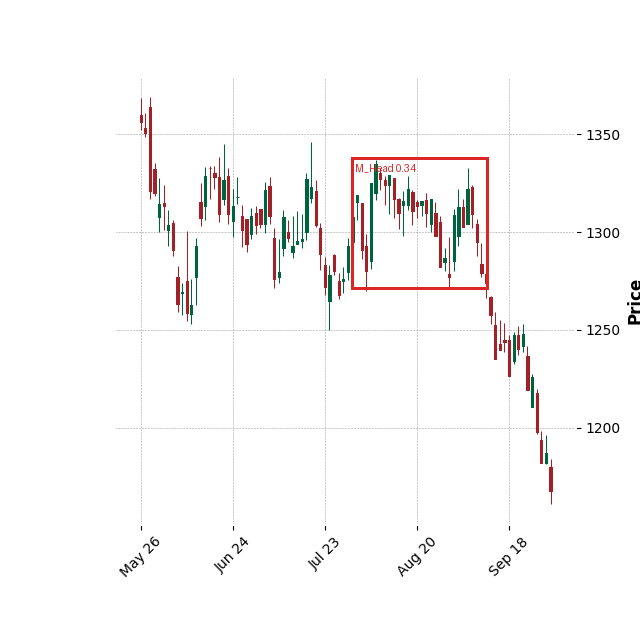
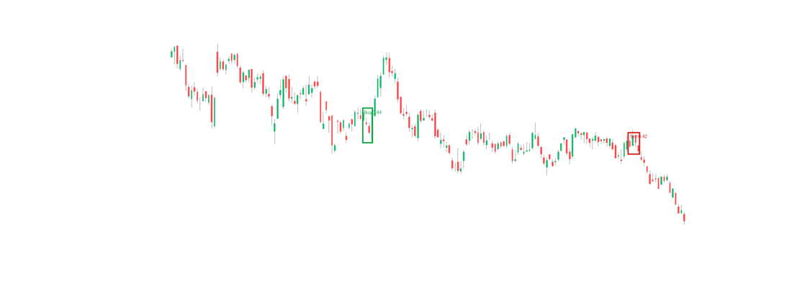
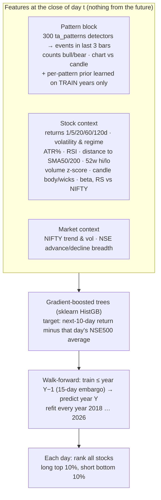
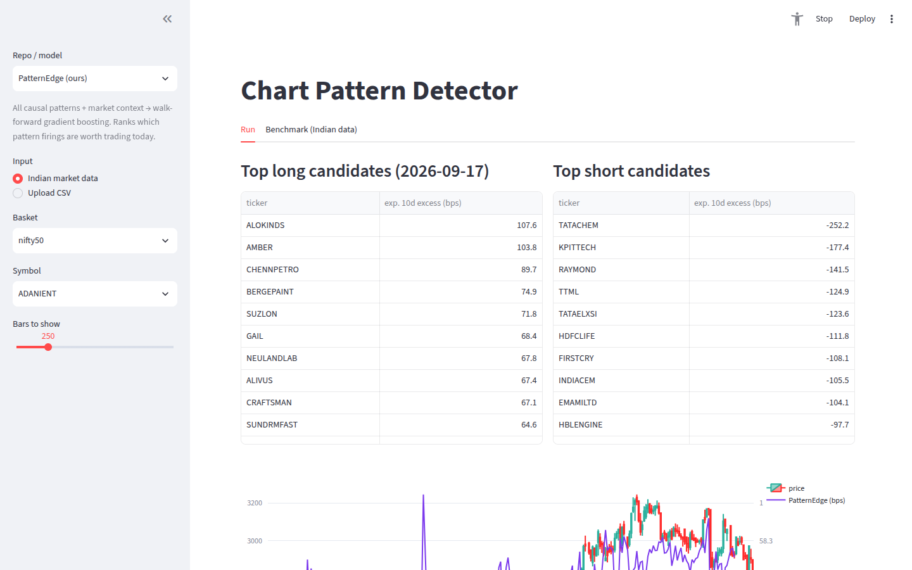

# chart-pattern-detector

A curated list of open-source **chart-pattern detection and price-pattern models**. Every repo here is
**runnable in one app** and **benchmarked on the same Indian market data** (NSE stocks and indices),
using one causal yardstick.

The final section is **PatternEdge**: what we built after watching every repo fail in the same way.

```
streamlit run app.py      # pick a repo -> pick an NSE stock/index (or upload CSV / chart image) -> see detections/forecast
```


### In one picture: what happens when you test them all honestly


**How to read this chart:**
* **Bars:** Each bar is one repo or model. Its length is how much better (blue) or worse (red) its signal did than simply holding the same stock, over the next 10 trading days. The numbers are average basis points per signal, after the signal is known, on data the model never saw.
* **Rough edge vs noise:** `t` around 2 is a hint at best; `t` above 3, with thousands of signals, is a real effect.
* **Universes:** Rows marked **(NSE500)** cover all 499 NSE500 stocks. Every other row covers Nifty 50 stocks plus 5 NSE indices.
* **Takeaway:** No repo's raw pattern signal beats noise on Indian large caps. A model that learns *when* patterns and context matter does (PatternEdge, ↓).

### How everything fits together



The rule that matters most: **a signal is stamped on the bar where it could actually have been known.**
Several repos quietly use future bars, for example a centred pivot window that needs 3 to 10 bars that haven't happened yet. On a backtest that looks like magic; live it is impossible. Every such leak is fixed in the adapters (see below), and `python -m cpd.rules` checks it: detections made with data up to a past date must not change when later bars are added.

### What each kind of model looks like

| Rule-based: stock-pattern geometry and ta_patterns events | Foundation-model forecasts vs reality |
|---|---|
|  |  |

* **Rule-based (left):** ta_patterns fires on almost every bar (▲/▼). That is why raw patterns are noise on their own and need a model on top to pick out the few that matter.
* **Forecasters (right):** they tend to predict "roughly flat, with a wide band", which is a sensible answer for daily stock prices and also why their directional edge is small.

| foduucom YOLOv8: patterns on a chart image | ChartScanAI YOLOv8: Buy/Sell boxes |
|---|---|
|  |  |

The vision models find shapes that look right, but **after the fact**. The `M_Head` (double top) box above sits on a pattern whose breakdown had already happened. Only boxes that reach the right edge of the chart could be traded, and in the benchmark those barely beat noise.

---

## The curated list

| # | Repo | ⭐ | Type | Input | What it outputs | Runs here |
|---|------|---:|------|-------|-----------------|:---:|
| 1 | [AdventuresInDataScience/ta_patterns](https://github.com/AdventuresInDataScience/ta_patterns) | 1 | Rules (numpy) | OHLCV | 300 signed per-bar signals (106 candlestick + 194 chart) | ✅ |
| 2 | [BennyThadikaran/stock-pattern](https://github.com/BennyThadikaran/stock-pattern) | 417 | Rules (pivot geometry) | OHLCV | 21 patterns with points: DTOP/DBOT, H&S, triangles, flags, VCP, ABCD/Bat/Gartley/Crab/Butterfly | ✅ |
| 3 | [zeta-zetra/chart_patterns](https://github.com/zeta-zetra/chart_patterns) | 126 | Rules (pivots + regression) | OHLC | doubles, triangles, H&S, inverse H&S, flag, pennant | ✅ |
| 4 | [white07S/TradingPatternScanner](https://github.com/white07S/TradingPatternScanner) | 318 | Rules (rolling masks) | OHLC | H&S, double, triangle, wedge, channel labels per bar | ✅ |
| 5 | [xxwikkixx/HarmonicPattern](https://github.com/xxwikkixx/HarmonicPattern) | 57 | Rules (XABCD Fibonacci) | Close | Gartley / Butterfly / Bat / Crab ±1 | ✅ |
| 6 | [ednunezg/pytrendline](https://github.com/ednunezg/pytrendline) | 148 | Rules (trendline search) | OHLC | scored support/resistance trendlines | ✅ (visual) |
| 7 | [foduucom/Stockmarket-pattern-detection](https://github.com/foduucom/Stockmarket-pattern-detection) ([weights](https://huggingface.co/foduucom/stockmarket-pattern-detection-yolov8)) | 24 | YOLOv8s detector | Chart image | boxes: H&S top/bottom, M_Head, W_Bottom, Triangle, StockLine | ✅ |
| 8 | [Omar-Karimov/ChartScanAI](https://github.com/Omar-Karimov/ChartScanAI) | 183 | YOLOv8 detector | Chart image | boxes: Buy / Sell | ✅ |
| 9 | [shiyu-coder/Kronos](https://github.com/shiyu-coder/Kronos) | 41.9k | Foundation model (K-line tokens + decoder transformer) | OHLCV | sampled future candles | ✅ mini |
| 10 | [amazon-science/chronos-forecasting](https://github.com/amazon-science/chronos-forecasting) | 6.2k | Foundation model (T5 / patch transformer) | Series | quantile forecast | ✅ Chronos-2 small |
| 11 | [google-research/timesfm](https://github.com/google-research/timesfm) | 34.6k | Foundation model (patch decoder) | Series | quantile forecast | ✅ 2.5-200M |
| 12 | [nsarang/big-data-stock-price-forecast](https://github.com/nsarang/big-data-stock-price-forecast) | 2 | 1D-conv VAE + nearest-neighbour analogs | Close | forecast = futures of the most similar past windows | ✅ |
| 13 | [omerbsezer/TimeSeries2DBarChartImageCNN](https://github.com/omerbsezer/TimeSeries2DBarChartImageCNN) | 42 | CNN on 30×30 bar images | Close | Buy/Hold/Sell | 📖 no weights |
| 14 | [przemyslawbak/OHLC_Candlestick_Patterns](https://github.com/przemyslawbak/OHLC_Candlestick_Patterns) | 38 | Rules (C#/.NET) | OHLC | 74 candle + 23 formations + 12 Fibonacci patterns | 📖 .NET |

**Also worth knowing**, found with GitHub search but not wired into the app:

* **Classic indicator libraries:** [TA-Lib/ta-lib-python](https://github.com/TA-Lib/ta-lib-python) (61 `CDL*` candlestick functions; the de-facto reference) and [hackingthemarkets/candlestick-screener](https://github.com/hackingthemarkets/candlestick-screener) (a Flask UI over TA-Lib).
* **Python pattern libraries:**
  * [tan-yang/pt-lib](https://github.com/tan-yang/pt-lib): 28 patterns including harmonics.
  * [tempusoneps/ohlcpattern](https://github.com/tempusoneps/ohlcpattern)
  * [beinghorizontal/Support-Resistance](https://github.com/beinghorizontal/Support-Resistance)
* **Vision models:**
  * [SyedAbdullahh/Stock-Chart-Pattern-Detection-Using-YOLOv8](https://github.com/SyedAbdullahh/Stock-Chart-Pattern-Detection-Using-YOLOv8): a TradingView Chrome extension that uses foduucom's weights.
  * [antoine-mtl/Head-and-shoulders-pattern-detection](https://github.com/antoine-mtl/Head-and-shoulders-pattern-detection): a CNN for H&S.
* **Other time-series foundation models** that would slot into `cpd/forecast.py` the same way:
  * [time-series-foundation-models/lag-llama](https://github.com/time-series-foundation-models/lag-llama)
  * [Time-MoE/Time-MoE](https://github.com/Time-MoE/Time-MoE)
  * [moment-timeseries-foundation-model/moment](https://github.com/moment-timeseries-foundation-model/moment)
  * [ibm-granite/granite-tsfm](https://github.com/ibm-granite/granite-tsfm) (TinyTimeMixer)
  * [Nixtla/nixtla](https://github.com/Nixtla/nixtla) (TimeGPT, API)

---

## How each one works, and what we had to fix

The questions that matter for any pattern model are: **when is the pattern known, and does knowing it predict anything?**
We read every repo's source and ran each one bar by bar.

### Rule-based detectors

* **ta_patterns**
  * **How it works:** Pure numpy. Pivots are confirmed `pivot_n=5` bars late, and `mode="confirmed"` waits for the breakout.
  * **Lookahead:** We verified it has none: detections on a prefix equal detections on the full series.
  * **Gotchas:** Outputs are *states*, not events: `double_top` stays on for hundreds of bars. We emit the bar where a state switches on. No geometry is returned.
* **stock-pattern**
  * **How it works:** Pivots come from `get_max_min` (a centred window of 7 left / 5 right bars, despite the args saying 6/6), then each `find_*` checks pivot geometry *as of the last bar*.
  * **Lookahead:** A pivot is only known 5 bars after it happens. The repo's own `backtest.py` computes pivots on the full df, so it leaks the future, and it also crashes (it never passes `config`).
  * **Our fix:** We compute pivots once, mask each pivot until its confirmation bar, and walk forward every 3 bars.
* **chart_patterns**
  * **How it works:** `scipy` pivots over the whole series with a ±3-bar centred window (±10 for H&S), then `linregress` on highs and lows.
  * **Lookahead:** A detection stamped at bar *i* needs bar *i+3*. **Our fix:** we move each signal forward by the lag.
  * **Bugs:**
    * `double="both"` never finds bottoms.
    * Slope thresholds are absolute forex units, so ascending and descending triangles never fire on equities.
* **TradingPatternScanner**
  * **How it works:** It flags 3-bar wiggles, not real H&S or triangles.
  * **Lookahead:** It uses `shift(-1)`, which peeks 1 bar ahead. **Our fix:** we delay its signals by one bar.
  * **Bug:** The "Multiple Top" condition can never be true.
  * **Variants:** The `_tech` variants (Kalman, wavelet, Savitzky-Golay) smooth the whole series, so they peek further ahead.
* **HarmonicPattern**
  * **How it works:** `argrelextrema(order=10)` with `clip` mode.
  * **Lookahead:** On the full series it peeks 10 bars ahead. **Our fix:** we run it on prefixes.
  * **Gotchas:**
    * A pivot can be flagged with only 1 bar to its right, so pivots repaint.
    * `err_allowed` is additive, not a percentage.
    * There is no XD check.
* **pytrendline**
  * **How it works:** It brute-forces all pivot pairs (roughly O(n³)) and scores the resulting lines.
  * **Lookahead:** Breakouts are judged on the whole window.
  * **Our use:** We keep it as a visual tool only.

### Vision models (YOLOv8)

* **foduucom**
  * **Training:** 9k training images labelled in Roboflow; the dataset isn't published. The README claims mAP50 0.93, but its own `config.json` says 0.61.
* **ChartScanAI**
  * **Training:** Buy and Sell boxes labelled by hand on mplfinance `yahoo` charts, with no published dataset or metrics.
* **The problem with both:** the annotator saw the bars *after* the pattern, so the labels have hindsight built in. A box in the middle of a chart describes a pattern that already played out.
* **What we do:**
  1. Render the trailing chart in each model's training style.
  2. Map each box's pixels back to dates.
  3. Count a box as a signal only if it reaches the last bars (`at_edge`).

### Forecasters

* **Kronos**
  * **How it works:** A BSQ tokenizer turns each OHLCV candle into two hierarchical tokens, and a decoder transformer then samples future candles autoregressively.
  * **Gotcha:** `predict()` *averages* its samples, so to get a distribution we batch copies of the series.
  * **Setup used:** `NeoQuasar/Kronos-mini` (4M parameters) with `Kronos-Tokenizer-2k`.
* **Chronos-2**
  * **How it works:** Patch-based encoder over the mean-scaled series, outputting quantile heads.
  * **Setup used:** `autogluon/chronos-2-small` (28M parameters).
* **TimesFM 2.5**
  * **How it works:** A 200M-parameter patch decoder with a continuous quantile head.
  * **Cost:** About 2 GB of RAM on CPU.
* **nsarang**
  * **How it works:** A VAE (latent size 32) embeds z-scored 256-bar windows; the forecast is the future of the nearest past windows by L1 distance on `[μ, logσ²]`.
  * **Training data:** Hourly crypto, so daily NSE equities are out of distribution.
  * **Problems with the original:**
    * Its notebook doesn't stop matches from overlapping the query.
    * Its top-2 matches are usually adjacent windows.
    * It has no baseline.

### Not runnable (documented)

* **TimeSeries2DBarChartImageCNN**
  * **Why not:** It publishes no weights.
  * **Bugs:**
    * Thresholds come from the 4-day return while the labels use the 15-day return.
    * Its class "balancing" duplicates every class, so nothing changes.
    * Its own results file scores 34% on 3 classes, which is chance level.
* **OHLC_Candlestick_Patterns**
  * **Why not:** It is C#/.NET.
  * **Coverage:** Its candlestick rules are covered by ta_patterns.
  * **Gotcha:** Some of its rules use exact float equality (`Low == Open`).

---

## Benchmark on Indian data

**Setup:**
* **Universe:** 53 Nifty 50 stocks (current constituents, so survivorship bias applies) plus 5 NSE indices: NIFTY 50, NIFTYBANK, NIFTYIT, NIFTYMIDCAP100 and NIFTYMIDCAPSELECT.
* **Period:** 2018-01-01 to 2026-10.
* **Signal:** The pattern is known at the close of *t*; enter at the next open, exit at the close of *t+10*.
* **Scoring** (`cpd/evaluate.py`):
  * **excess_bps:** direction × (forward return − the ticker's unconditional mean forward return). This removes the free "everything went up" return longs get in a bull market.
  * **net_bps:** after a 20 bps round-trip cost.
  * **t:** computed over daily means. Horizons overlap, so treat |t| < 3 as noise.
* **Data hygiene:** We drop signals within 140 bars of a >35% one-day move, because the stock cache is not verified to be split/bonus adjusted.

**Results** (`results/summary.csv`):

| Method | Universe | Signals | Hit rate | Excess (bps / 10 d) | t | Long-only excess |
|---|---|---:|---:|---:|---:|---:|
| **PatternEdge (ours)** | NSE500 | 184,011 | 53.8% | **+61** | **19.4** | **+51** |
| Context-only model (ablation) | NSE500 | 183,984 | 53.5% | +57 | 17.8 | +45 |
| Patterns-only model (ablation) | NSE500 | 184,011 | 51.2% | +20 | 10.7 | +11 |
| Chronos-2 small | NSE500 | 45,705 | 50.5% | +9 | −0.3 | +50 |
| Kronos mini *(partial run)* | Nifty50 + indices | 367 | 51.8% | +57 | 0.2 | +284 |
| Chronos-2 small | Nifty50 + indices | 5,980 | 51.7% | +17 | 0.0 | +40 |
| VAE analogs (nsarang) | Nifty50 + indices | 5,980 | 51.9% | +4 | 1.7 | +31 |
| TradingPatternScanner | Nifty50 + indices | 124,764 | 50.8% | 0 | 0.2 | −1 |
| ta_patterns (all 300) | Nifty50 + indices | 1,302,284 | 50.1% | −2 | −0.3 | −3 |
| TimesFM 2.5 | Nifty50 + indices | 5,980 | 49.5% | −2 | 0.4 | +31 |
| foduucom YOLOv8 *(partial run)* | Nifty50 + indices | 458 | 50.0% | −9 | 0.8 | +53 |
| PatternEdge (ours) | Nifty50 stocks only | 16,223 | 50.3% | −13 | −1.1 | −15 |
| chart_patterns | Nifty50 + indices | 2,736 | 50.5% | −14 | −2.1 | −12 |
| stock-pattern | Nifty50 + indices | 3,180 | 49.1% | −37 | −0.5 | −75 |
| ChartScanAI YOLOv8 | Nifty50 + indices | 286 | 44.1% | −66 | −1.5 | −54 |
| HarmonicPattern | Nifty50 + indices | 440 | 49.1% | −74 | −2.1 | −54 |

What this says:

1. **Classic chart patterns, used raw, have no edge on Indian large caps.** Every rule-based and vision repo lands within noise of zero, or below it, once you remove lookahead and compare against simply holding the stock. A 50% hit rate is a coin flip.
2. **Foundation models (Kronos, Chronos, TimesFM) are honest but bland.** They mostly forecast drift plus a band. Their *long* side looks positive, but that is largely the bull market, and the overall excess is not significant. Kronos looks interesting (rank IC 0.17), but on only 367 forecasts, which is not enough to trust yet.
3. **A few individual patterns do carry information** (see `per_pattern.csv` and the app's Benchmark tab). Examples: `busted_double_top` +94 bps (t = 3.4), and `busted_sym_triangle` reliably *fails* at −482 bps (t = −4.6), so it is a contrarian signal. The skill is knowing which pattern, in which context, and that is a learning problem.


---

## PatternEdge: what an ML engineer builds next

Watching all of the above, the failure is always the same: **a pattern is treated as a fixed rule that always means the same thing.**
In reality a double bottom in a stock that is 40% below its 200-day average, during a falling market with weak breadth, is a different object from the same shape in a leader making new highs.
So PatternEdge does not invent another detector. It **learns when the existing detectors are worth listening to.**



**Why these choices:**

* **Target-encoded pattern priors.** Each of the 300 patterns gets a shrunk average of its past signed excess return. The average is computed *only on training years*, so the model knows that `busted_sym_triangle` fails and `busted_double_top` works, without seeing the test year.
* **Cross-sectional target.** Subtracting each day's market average removes the bull-market tailwind. The model has to say *which stocks beat the others*, not "stocks go up".
* **Purged walk-forward validation.** No random K-fold, which leaks overlapping 10-day labels across folds. Each year is predicted by a model that has never seen it, with a 15-day gap between train and test.
* **Ablations, run in exactly the same way:** context only, and patterns only.

**Results** (NSE500, 2018 → 2026, about 1M test predictions):


**What the decile chart shows:**
* **The ranking works across the whole range:** decile 10 (the model's most bullish 10% each day) beat the average stock by **+62 bps over 10 days**, decile 1 lagged by **−80 bps**, and every decile in between lines up in order.
* **Daily rank IC is 0.064** (IC-IR 0.53).
* **Net of costs:** with 20 bps round-trip cost, the top/bottom-decile signals earn **+52 bps net per trade** in the benchmark above.


**The honest finding from the ablation:**
* **Context carries most of the signal.** Trend, mean-reversion and regime features alone reach IC 0.063.
* **Patterns alone are weak but real:** IC 0.02 to 0.035, positive in every year. They are also **decaying**: 0.035 in 2019–2020, under 0.02 since 2023.
* **Adding patterns to context helps only slightly:** +4 bps per signal and +0.001 IC.

This is what you would expect if chart patterns are widely known and arbitraged away.



**Limits, read before trading anything:**
* **Survivorship bias:** The universe is today's NSE500. Stocks that crashed out of the index are missing, which flatters "buy the beaten-down" signals. Historical index membership is needed to fix this.
* **The edge lives in mid and small caps:** On Nifty 50 stocks PatternEdge is −13 bps, which is noise. Large caps are efficient at a 10-day horizon.
* **Shorting is limited in India:** The short side is only possible for F&O stocks (via futures). The long-only column is the realistic one: **+51 bps excess per signal.**
* **No capacity or slippage model:** Small-cap impact costs can exceed 20 bps.
* **Unadjusted prices:** The price cache is not certified split/bonus-adjusted. We drop windows around >35% one-day moves.

**Where to take it next:**
* Use point-in-time NSE500 membership.
* Add Kronos or Chronos embeddings as features: `cpd/forecast.py` already loads both, and both expose `embed()` or hidden states.
* Model the long side alone for cash-equity accounts.
* Re-evaluate at a 5-day and a 20-day horizon.


---

## Run it

```bash
# 1. environment (CPU is enough)
uv venv .venv --python 3.10 && source .venv/bin/activate
uv pip install torch --index-url https://download.pytorch.org/whl/cpu
uv pip install -r requirements.txt

# 2. clone the curated repos at tested commits (kept outside this repo; several have no licence or are GPL)
scripts/setup_vendor.sh            # -> ~/.cache/chart-pattern-detector/vendor  (override: CPD_VENDOR)

# 3. point at your data (never committed)
export CPD_STOCK_ROOT=/path/to/market-data     # index.csv + daily/*.csv (date,open,high,low,close,volume)
export CPD_INDEX_CSV=/path/to/idx_data.csv     # Ticker,Date(dd-mm-yyyy),Open,High,Low,Close,Volume
export CPD_BREADTH_CSV=/path/to/NSE_ADV_DEC.csv

# 4. app
streamlit run app.py

# 5. reproduce the benchmark (low priority, 2 threads each)
scripts/run_bench.sh ta_patterns stock-pattern chart_patterns TradingPatternScanner HarmonicPattern
scripts/run_bench.sh "Chronos-2 (small)" "Kronos (mini)" "TimesFM 2.5" "VAE analog (nsarang)" ChartScanAI foduucom-yolov8
python -m cpd.edge build && python -m cpd.edge fit && python -m cpd.edge fit --no-patterns && python -m cpd.edge fit --no-context
python -m cpd.bench report
python scripts/make_figures.py      # regenerate docs/img
```

Self-checks: `python -m cpd.rules` (includes a no-lookahead test), `python -m cpd.vision`, `python -m cpd.forecast`.

### Layout

```
app.py            Streamlit UI
cpd/data.py       Indian data loader (stocks + indices), corporate-action guard
cpd/rules.py      adapters: ta_patterns, stock-pattern, chart_patterns, TradingPatternScanner, HarmonicPattern, pytrendline
cpd/vision.py     adapters: foduucom YOLOv8, ChartScanAI (render -> detect -> boxes back to dates)
cpd/forecast.py   adapters: Kronos, Chronos-2, TimesFM 2.5, nsarang VAE analogs
cpd/evaluate.py   the one yardstick
cpd/bench.py      run every method on the same universe, score, report
cpd/edge.py       PatternEdge
scripts/          setup_vendor.sh, run_bench.sh, make_figures.py
docs/img/         README figures
```

**Licences:** This repo contains only adapter code. The upstream repos are cloned at runtime and keep their own licences: several have none, and stock-pattern is GPL-3.0.
