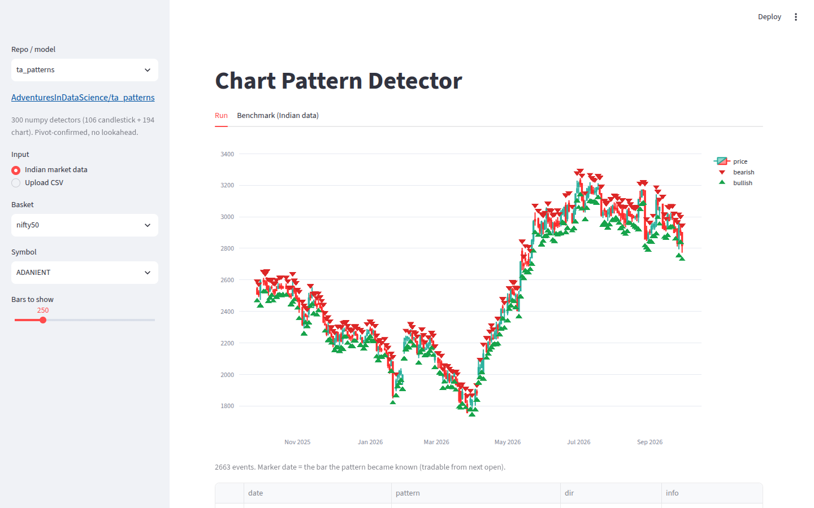
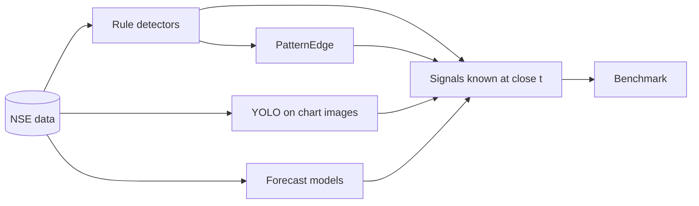

# chart-pattern-detector

Every open-source chart-pattern model in one app, tested honestly on Indian market data, plus **PatternEdge**, a model that learns *when* patterns are worth trading.



## What we built

1. **One app** (`streamlit run app.py`): pick a repo, pick any NSE stock or index (or upload a CSV or chart image), and see its detections or forecast.
2. **One fair benchmark**: every repo is scored the same way on NSE data, 2018 → 2026. The signal is known at the close, you enter at the next open and exit 10 bars later, and the result is measured against simply holding the stock.
3. **PatternEdge**: 300 pattern detectors plus market context, fed to gradient boosting and validated walk-forward.



## The repos

| Repo | Type | Fix we applied |
|---|---|---|
| [ta_patterns](https://github.com/AdventuresInDataScience/ta_patterns) | 300 candle + chart rules | none needed (no lookahead) |
| [stock-pattern](https://github.com/BennyThadikaran/stock-pattern) | pivot geometry (H&S, triangles, harmonics) | pivots masked until confirmed (+5 bars) |
| [chart_patterns](https://github.com/zeta-zetra/chart_patterns) | pivots + regression | signals delayed 3–10 bars (repo peeks ahead) |
| [TradingPatternScanner](https://github.com/white07S/TradingPatternScanner) | rolling masks | signals delayed 1 bar |
| [HarmonicPattern](https://github.com/xxwikkixx/HarmonicPattern) | Gartley / Bat / Crab / Butterfly | run on prefixes only |
| [pytrendline](https://github.com/ednunezg/pytrendline) | trendlines | visual only |
| [foduucom YOLOv8](https://github.com/foduucom/Stockmarket-pattern-detection) | image detector | only boxes at the chart's right edge count |
| [ChartScanAI](https://github.com/Omar-Karimov/ChartScanAI) | image Buy/Sell detector | same |
| [Kronos](https://github.com/shiyu-coder/Kronos) | OHLCV foundation model | sample paths → quantiles |
| [Chronos](https://github.com/amazon-science/chronos-forecasting) | time-series foundation model | — |
| [TimesFM](https://github.com/google-research/timesfm) | time-series foundation model | — |
| [big-data-stock-price-forecast](https://github.com/nsarang/big-data-stock-price-forecast) | VAE + nearest past windows | no matching on overlapping windows |
| [TimeSeries2DBarChartImageCNN](https://github.com/omerbsezer/TimeSeries2DBarChartImageCNN) | CNN on bar images | not runnable (no weights) |
| [OHLC_Candlestick_Patterns](https://github.com/przemyslawbak/OHLC_Candlestick_Patterns) | C# rules | not runnable (.NET); covered by ta_patterns |

## Results


- **Raw patterns are noise on Indian large caps.** No rule-based or YOLO repo beats holding the stock once its lookahead is removed.
- **The forecasters (Kronos, Chronos, TimesFM) predict mostly drift**, so their directional edge is small and not statistically significant.
- **PatternEdge earns +61 bps per 10-day signal on NSE500** (+51 bps for longs only), with t ≈ 19.


**The honest part:**
- Most of PatternEdge's edge comes from market context: trend, regime and breadth.
- Patterns alone are weak and have been decaying since 2023.
- The edge is in mid and small caps; on Nifty 50 it's noise.
- The universe is today's NSE500, so stocks that dropped out are missing (survivorship bias).

## Run

```bash
uv venv .venv --python 3.10 && source .venv/bin/activate
uv pip install torch --index-url https://download.pytorch.org/whl/cpu && uv pip install -r requirements.txt
scripts/setup_vendor.sh                       # clones the repos above at tested commits

export CPD_STOCK_ROOT=/path/to/stocks         # index.csv + daily/*.csv  (date,open,high,low,close,volume)
export CPD_INDEX_CSV=/path/to/idx_data.csv    # Ticker,Date,Open,High,Low,Close,Volume
export CPD_BREADTH_CSV=/path/to/NSE_ADV_DEC.csv
streamlit run app.py
```

Reproduce the benchmark: `scripts/run_bench.sh <method>…`, then `python -m cpd.edge build && python -m cpd.edge fit`, `python -m cpd.bench report`, and `python scripts/make_figures.py`.

```
app.py           UI
cpd/rules.py     rule-based adapters      cpd/vision.py    YOLO adapters
cpd/forecast.py  forecaster adapters      cpd/edge.py      PatternEdge
cpd/bench.py     benchmark                cpd/evaluate.py  scoring
```

Market data is never committed. Upstream repos are cloned at runtime and keep their own licences.
