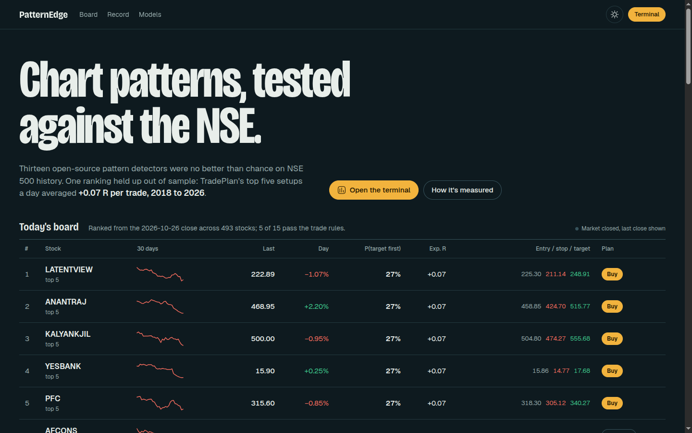
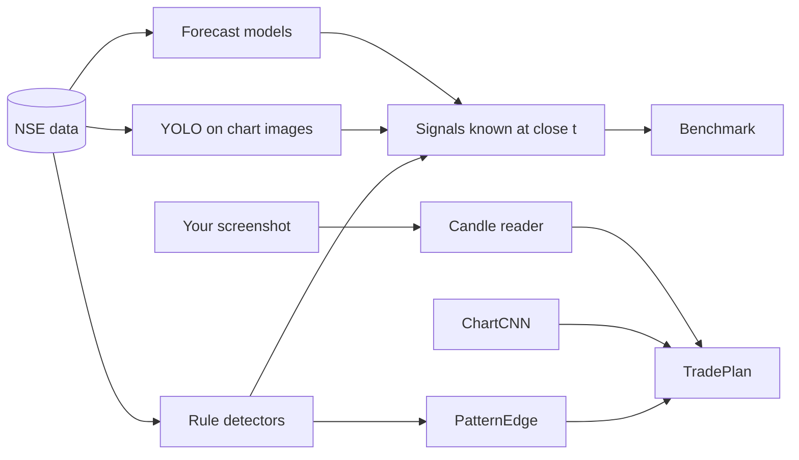
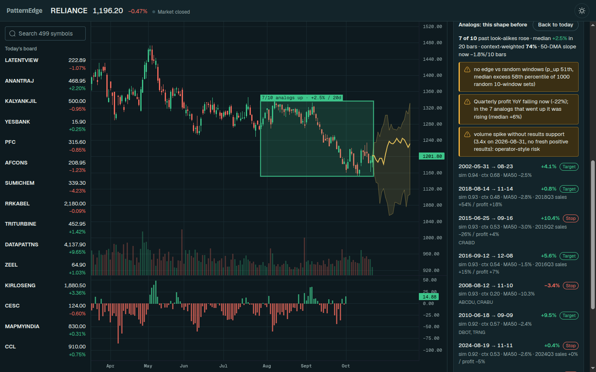
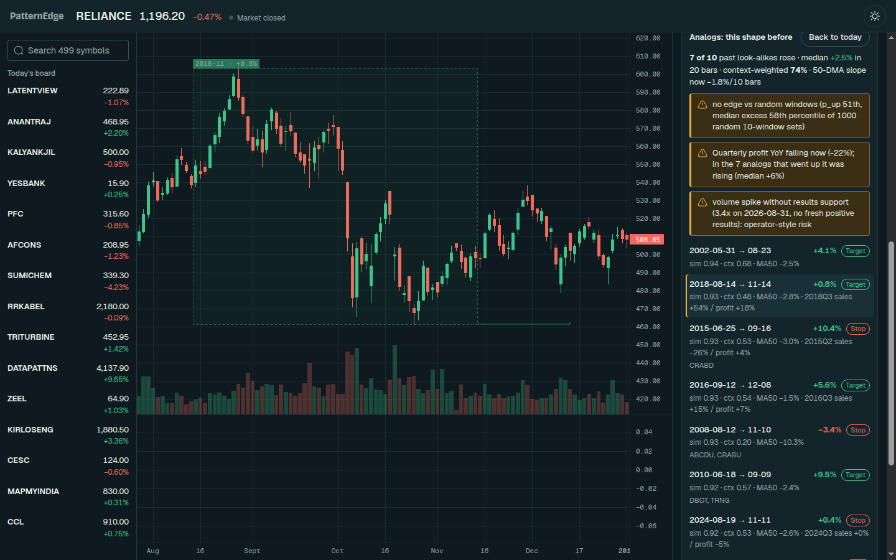
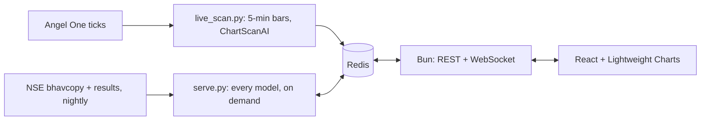
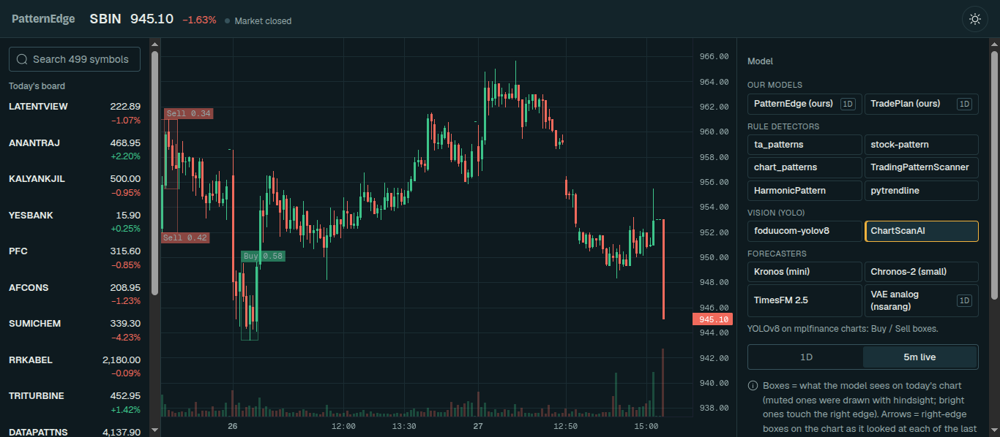

<h1 align="center">
    Chart-Pattern-Detector
</h1>

Every open-source chart-pattern model in one live web app, tested honestly on Indian market data. On top of them we built:
- **PatternEdge**, which ranks pattern signals and finds look-alike charts in each stock's own history;
- **TradePlan**, which gives entry, stop, target and a probability for any NSE stock.

Every number comes with an out-of-sample track record.



## What we built

1. **A live web app**: React with TradingView Lightweight Charts, a Bun WebSocket server, Redis, and the Python models.
   - Pick any NSE stock and any of the 14 models, and see its signals drawn in that model's own style.
   - The home page shows today's top TradePlan setups at live prices.
   - Charts can show daily bars or **live 5-minute bars** streamed from Angel One.
2. **One fair benchmark**: every repo is scored the same way on NSE data, 2018 → 2026.
   - The signal is known at the close; you enter at the next open and exit 10 bars later.
   - Each result is measured against simply holding the stock.
3. **PatternEdge**:
   - 300 pattern detectors plus market context, fed to gradient boosting and validated walk-forward.
   - **Analogs**: "this stock drew this shape before; what happened next, and is today's context the same?" Includes the 50-DMA slope, NIFTY trend, volume, and quarterly results as known on that date.
4. **ChartCNN**: a chart-image model that *predicts* instead of detecting (Jiang, Kelly & Xiu 2023), trained on NSE charts.
5. **TradePlan**: PatternEdge plus ChartCNN turned into a trade plan, for an NSE stock or for any chart screenshot.
6. **Data you can trust and download**, rebuilt every night:
   - NSE daily bars from the official bhavcopy, with splits and bonuses adjusted.
   - NSE quarterly results with their announcement time, so the model never sees a result before it was public.
   - Trained models.
   - All of it as a GitHub release, so nothing needs training.



## The repos

| Repo | Type | Fix we applied |
|---|---|---|
| [ta_patterns](https://github.com/AdventuresInDataScience/ta_patterns) | 300 candle + chart rules | none needed (no lookahead) |
| [stock-pattern](https://github.com/BennyThadikaran/stock-pattern) | pivot geometry (H&S, triangles, harmonics) | pivots masked until confirmed (+5 bars) |
| [chart_patterns](https://github.com/zeta-zetra/chart_patterns) | pivots + regression | signals delayed 3–10 bars (repo peeks ahead) |
| [TradingPatternScanner](https://github.com/white07S/TradingPatternScanner) | rolling masks | signals delayed 1 bar |
| [HarmonicPattern](https://github.com/xxwikkixx/HarmonicPattern) | Gartley / Bat / Crab / Butterfly | run on prefixes only |
| [pytrendline](https://github.com/ednunezg/pytrendline) | trendlines | visual only |
| [foduucom YOLOv8](https://github.com/foduucom/Stockmarket-pattern-detection) | image detector | only boxes at the chart's right edge count |
| [ChartScanAI](https://github.com/Omar-Karimov/ChartScanAI) | image Buy/Sell detector | same |
| [Kronos](https://github.com/shiyu-coder/Kronos) | OHLCV foundation model | sample paths → quantiles |
| [Chronos](https://github.com/amazon-science/chronos-forecasting) | time-series foundation model | — |
| [TimesFM](https://github.com/google-research/timesfm) | time-series foundation model | — |
| [big-data-stock-price-forecast](https://github.com/nsarang/big-data-stock-price-forecast) | VAE + nearest past windows | no matching on overlapping windows |
| [TimeSeries2DBarChartImageCNN](https://github.com/omerbsezer/TimeSeries2DBarChartImageCNN) | CNN on bar images | not runnable (no weights) |
| [OHLC_Candlestick_Patterns](https://github.com/przemyslawbak/OHLC_Candlestick_Patterns) | C# rules | not runnable (.NET); covered by ta_patterns |

## TradePlan: from detecting to predicting

**Why it was needed.** ChartScanAI, foduucom and similar tools *detect*. Their training boxes were drawn by people who already knew what happened next, so on the newest candle they almost never fire, and when they do they're wrong. We tested ChartScanAI at the right edge: a 33–44% hit rate and negative returns. Paid tools like BullGPT return entry, stop and target from a screenshot, but publish no track record. Research on vision AI models reading candlestick charts finds them at 49–53%, close to a coin flip ([Hu et al. 2026](https://arxiv.org/abs/2604.12659)).

**What we built instead.** Every number below is learned from what happened *after* the chart and tested on years the model never saw.

| Piece | How it works |
|---|---|
| **ChartCNN** | 20-day black-and-white chart images (OHLC bars, 20-day average, volume), as in [Jiang, Kelly & Xiu 2023](https://doi.org/10.1111/jofi.13268). The label is "did this stock beat the day's average NSE500 stock over the next 10 days?". Trained on 2005–2010 only, then tested 2013–2026: **51.8% accuracy, rank IC 0.031**. The paper found US-trained models fail in India, so this one is trained locally. |
| **Trade levels** | Entry at the next open, stop 1.5 ATR below, target 2.5 ATR above, exit after 10 bars otherwise. Labels use this exact triple-barrier rule (López de Prado); if both levels are touched on the same bar, it counts as a stop. |
| **Models** | Gradient boosting on context, the 300 pattern events and ChartCNN, predicting both P(target before stop) and expected R. Costs of 0.3% per trade (STT, charges, slippage) are charged in R for each stock. |
| **Honest numbers** | Stocks are ranked each day. The probability and expected R shown in the app are what plans of the *same rank* actually earned in 2018–2026, because the raw model was about 0.1 R too optimistic. Only ranks whose history beats costs get **BUY**; everything else is **NO TRADE**. |
| **Screenshot path** | A colour-based candle reader pulls OHLC and volume out of a TradingView or broker screenshot; on test renders it matches the real candles at 0.9999 correlation. A separate model uses only what a picture can show (shapes in ATR units plus ChartCNN), and the plan lines are drawn on your image. |
| **Why** | Each input is swapped for a typical value to see how much it pushed the plan, plus a per-day map of which candles drove the CNN. |


| Rule, 2018 → 2026 out of sample (≈920k stock-days) | Win rate | Avg R after costs | Positive years |
|---|---:|---:|---:|
| Buy every stock | 22.9% | −0.029 | 3/9 |
| TradePlan, NSE stock: 5 best per day | 27.0% | **+0.069** | **6/9** |
| TradePlan, screenshot only: 5 best per day | 26.2% | +0.039 | 4/9 |

**Honest read:**
- **There is an edge, but it's small:** about +0.07 R per trade, roughly +0.4% after costs on a typical NSE500 stock.
- **It loses in falling-market years** (2018, 2019, 2025). Size positions small.
- **The CNN adds almost nothing on top of PatternEdge:** +0.069 R with it vs +0.068 R without. As the paper found, it mostly learns short-term reversal, which the context already captures.
- **The CNN is what makes screenshot plans possible,** because a picture carries no market context.
- **Other timeframes are untested:** the screenshot model is trained on daily NSE bars, so 1-minute charts are an extrapolation.


**Paper trading:** each evening, open the Trade plan tab and take the BUY rows (the top 5) at the next open, with the stop and target shown. Exit after 10 bars if neither level is hit. Compare your results with the history table in the app.

## Results


- **Raw patterns are noise on Indian large caps.** No rule-based or YOLO repo beats holding the stock once its lookahead is removed.
- **The forecasters (Chronos, TimesFM) predict mostly drift**, so their directional edge is small and not statistically significant.
- **Kronos is the most promising forecaster.** Over 1,004 forecasts its rank IC is 0.18, but the result is not yet significant (t ≈ 0.9).
- **PatternEdge earns +61 bps per 10-day signal on NSE500** (+51 bps for longs only), with t ≈ 19.


**The honest part:**
- Most of PatternEdge's edge comes from market context: trend, regime and breadth.
- Patterns alone are weak and have been decaying since 2023.
- The edge is in mid and small caps; on Nifty 50 it's noise.
- The universe is today's NSE500, so stocks that dropped out are missing (survivorship bias).

### PatternEdge analogs: does a stock repeat its own patterns?



For the last 60 bars of a stock, PatternEdge finds the 10 most similar past windows in that stock's own history, back to 1996 where data exists.
- **Similarity:** correlation of the normalised price shape.
- **Spacing:** matches are kept far enough apart that their outcomes don't overlap.
- **No peeking:** each match ends at least 20 bars before the day being scored, so its outcome was already known.

Each match is labelled with what happened in the next 20 bars, and with how its context compares to today:
- 50- and 200-DMA slope;
- NIFTY trend;
- volume;
- named patterns;
- quarterly sales and profit growth, as announced on NSE before that day.

**Flags:** when today's context differs from the analogs that worked, the app says so in plain English. For example: "50-DMA flat now; in the 7 analogs that went up it was rising", or "volume spike without results support: operator-style risk".

Every query is also compared against 1,000 sets of random windows from the same stock. If the look-alikes are no better than random, the app says so.

Clicking an analog jumps the chart to it:



**Walk-forward test**, NSE500, every day 2018–2026, against the 20-day return over NIFTY:
- "Rank IC" is the daily correlation between predicted and actual ranks across stocks.
- t-statistics use non-overlapping samples.
- The full table, including other window lengths and peer analogs, is in `analog_eval.csv` in the release.

| Signal | Rank IC | t |
|---|---|---|
| Share of analogs that rose (vs NIFTY) | 0.0107 | 2.5 |
| Same, weighted by context agreement | 0.0108 | 2.6 |
| Random past windows (control) | 0.0066 | 1.9 |
| Analogs whose 50-DMA slope **agrees** with today | 0.0097 | 2.3 |
| Analogs whose 50-DMA slope **disagrees** | 0.0021 | 0.9 |
| PatternEdge (gradient boosting) | 0.0638 | 8.1 |
| PatternEdge + analog features | 0.0628 | 8.3 |

**What this says:**
- Shape matching carries real information beyond random windows, and the user's moving-average intuition holds: analogs whose 50-DMA was sloping the same way as today predict; those that disagree don't.
- But the effect is small: about a sixth of PatternEdge's IC.
- Adding analog features to PatternEdge doesn't improve it out of sample. So the live ranking stays as it was, and analogs are shown as evidence and as a context check, not as the score.

## Platform (live web app)



- The models stay in Python; Bun only relays.
- Each model draws its signals in its own style:
  - rule detectors: arrows
  - YOLO models: boxes
  - forecasters: a cone
  - PatternEdge: analog boxes, a cone and a score panel
  - TradePlan: entry/stop/target zones
- **Daily or live 5-minute bars** for any NSE stock.
  - The 68-stock watchlist (Nifty 50 plus today's board) streams live ticks.
  - Any other stock fetches 60 days of 5-minute history the first time it's opened.
  - An evening job keeps every opened stock's history growing.
- **Yd page** (`/yd`): the 213 F&O stocks on 1m, 3m, 5m, 15m, 1h and 1D, from a second Angel One account (the `#Yd` block in `.env`, same keys commented under a `#Yd` header). The Yd strategy (volume shock + opening-range breakout/pullback, `cpd/yd.py`; not backtested) draws its setups, OR and VWAP on 1m-15m, VS_EOD on 1D, with a position-size calculator, and a screen ranks all F&O stocks by VS_time each 5-minute bar from the Yd account's live stream.
- The interfaces are documented in [`platform/CONTRACT.md`](platform/CONTRACT.md).



## Run

You need Python 3.10, [Bun](https://bun.sh) and Docker (for Redis). No training is needed: the release has the data and models.

```bash
git clone https://github.com/MananPoojara/chart-pattern-detector && cd chart-pattern-detector
uv venv .venv --python 3.10 && source .venv/bin/activate
uv pip install torch --index-url https://download.pytorch.org/whl/cpu && uv pip install -r requirements.txt
scripts/setup_vendor.sh      # clones the repos above at tested commits
python scripts/get_data.py   # NSE daily data, quarterly results, trained models
```

Then start the web app, one command per terminal:
```bash
docker run -d --name cpd-redis -p 127.0.0.1:6380:6379 redis:7-alpine redis-server --maxmemory 128mb --save ""
python -m cpd.serve                                   # model service; start 2 for more throughput
(cd platform/chart && bun install) && (cd platform/web && bun install && bun run build)
(cd platform/server && bun run start)                 # open http://localhost:8787
```

The older single-page Streamlit app still works: `streamlit run app.py`.

The [`data` release](https://github.com/MananPoojara/chart-pattern-detector/releases/tag/data) is rebuilt every trading night:
- **Daily data:** NSE500 stocks, 5 NSE indices and breadth, as Parquet/CSV.
  - New days come from NSE's official bhavcopy and index files.
  - Splits and bonuses are back-adjusted from NSE's adjusted previous close.
  - Symbol renames are followed by ISIN.
- **Quarterly results** (`fundamentals/quarterly.parquet`): sales, net profit and EPS for NSE500 from 2014.
  - Taken from NSE filings: the XBRL files, plus NSE's results pages before 2018.
  - Each result is timestamped at its first public NSE announcement, so features use only what was known on each day.
  - Spot-checked against company releases (RELIANCE, TCS, HDFCBANK, SBIN, GRANULES): the XBRL era matches exactly.
  - Known gaps: some 2018–19 quarters that NSE itself doesn't carry, and insurers before mid-2024.
- **Models:** retrained nightly, with today's plans.

**Live intraday (Angel One):** put `ANGEL_ONE_API_KEY`, `ANGEL_ONE_CLIENT_CODE`, `ANGEL_ONE_MPIN` and `ANGEL_ONE_TOTP_SECRET` in `.env`, which is gitignored. Then run `python scripts/live_scan.py` during market hours.
- It streams ticks from SmartStream, builds 5-minute bars, runs ChartScanAI on each finished bar, and publishes bars and signals to the app over Redis.
- The candle-history API throttles hard (403 "exceeding access rate" well below its documented limits), so history is fetched once per stock and then grown from the live ticks.

To use your own data, set `CPD_STOCK_ROOT` (index.csv + `daily/*.csv` or `bars.parquet`), `CPD_INDEX_CSV` and `CPD_BREADTH_CSV`. To update it, run `python scripts/update_data.py --out <dir>`.

Reproduce:
1. **Benchmark:** `scripts/run_bench.sh <method>…`, then `python -m cpd.bench report`.
2. **PatternEdge:** `python -m cpd.edge build && python -m cpd.edge fit`.
3. **ChartCNN:** `python -m cpd.chartcnn build && python -m cpd.chartcnn train && python -m cpd.chartcnn predict`.
4. **TradePlan:** `python -m cpd.tradeplan fit [--no-cnn | --image]`, then `python -m cpd.tradeplan final [--image]`.
5. **Analogs:** `python -m cpd.analog build && python -m cpd.analog eval`. Quarterly results: `python scripts/fetch_results.py --backfill`.
6. **Figures:** `python scripts/make_figures.py`.

```
app.py           UI
cpd/rules.py     rule-based adapters      cpd/vision.py    YOLO adapters
cpd/forecast.py  forecaster adapters      cpd/edge.py      PatternEdge
cpd/bench.py     benchmark                cpd/evaluate.py  scoring
cpd/chartcnn.py  chart-image CNN          cpd/tradeplan.py entry/stop/target models + backtest
cpd/digitize.py  screenshot -> candles    cpd/plan_ui.py   Trade plan tab
cpd/lwchart.py   Lightweight Charts + paper-trade levels
cpd/analog.py    own-history analogs     cpd/results.py   point-in-time quarterly results
cpd/serve.py     model service (Redis)   cpd/angel.py     Angel One login, ticks, 5-min history
platform/        Bun server, React web app, chart package, CONTRACT.md
scripts/live_scan.py  live 5-min scanner   scripts/fetch_results.py  NSE quarterly results
scripts/update_data.py  NSE daily update   scripts/get_data.py / publish_data.py  release download / upload
```

Market data is never committed. Upstream repos are cloned at runtime and keep their own licences. Nothing here is investment advice: it's a research tool with its track record attached.
