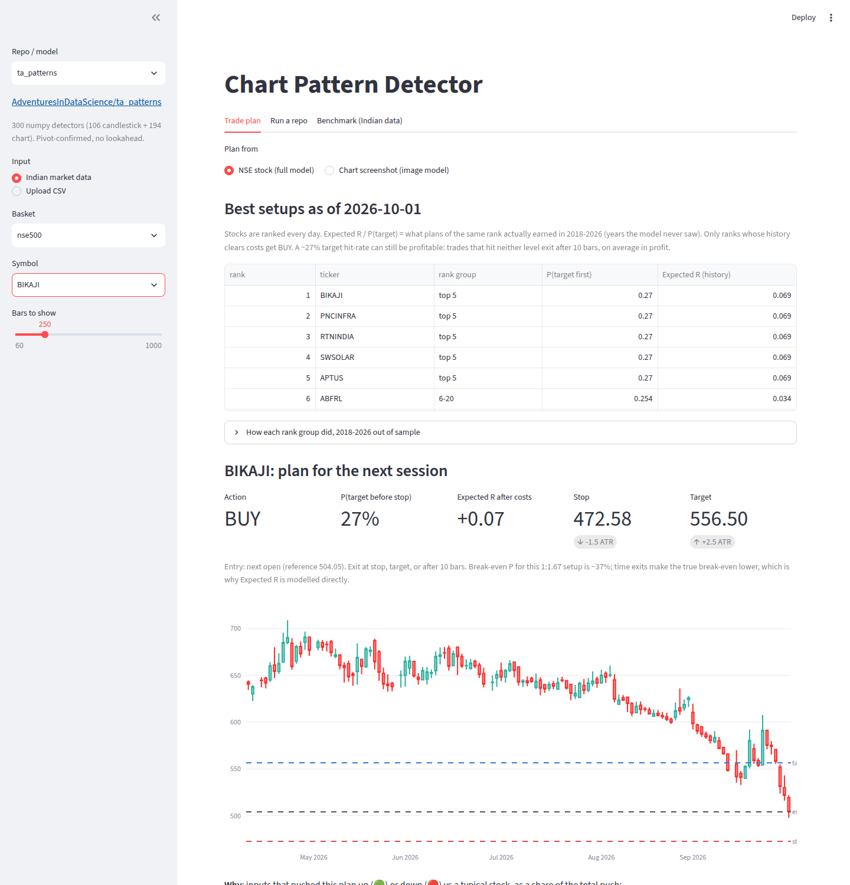
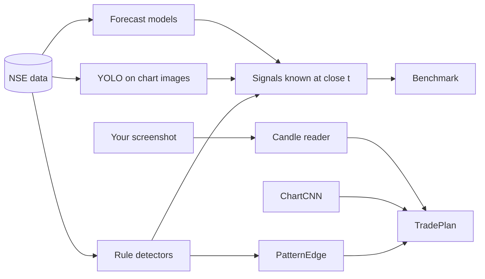
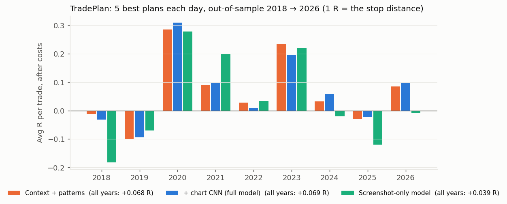
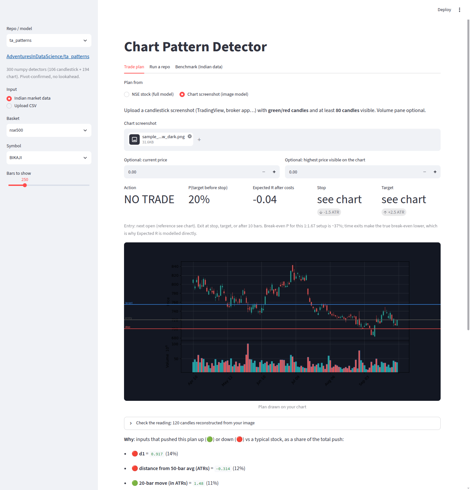
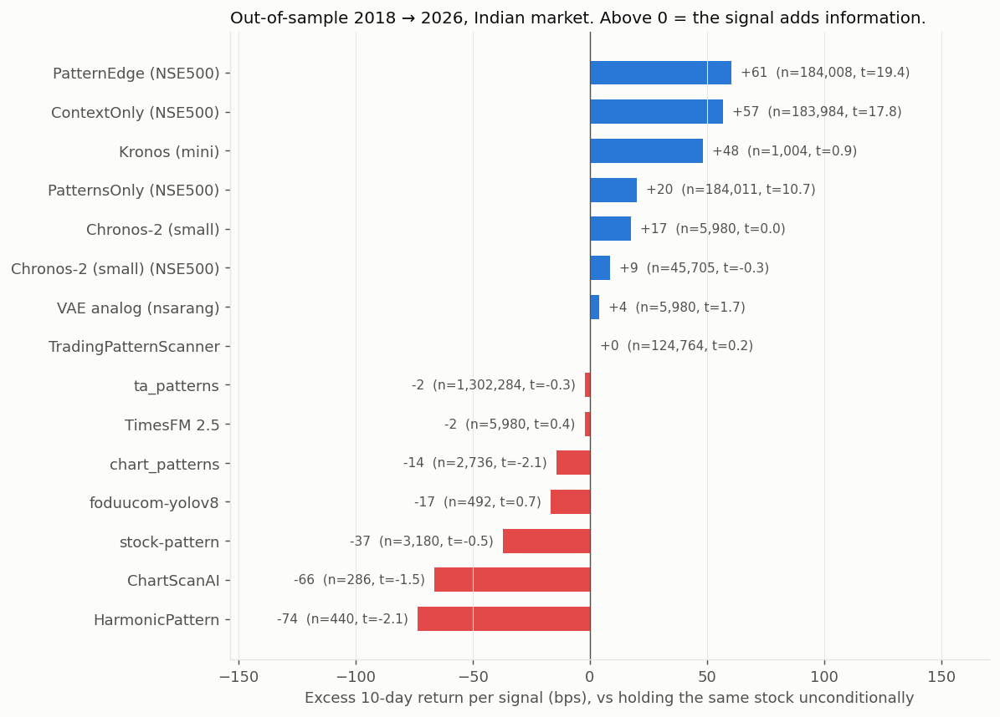
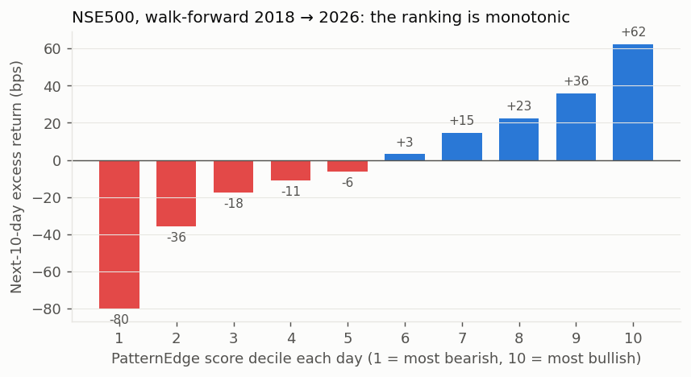
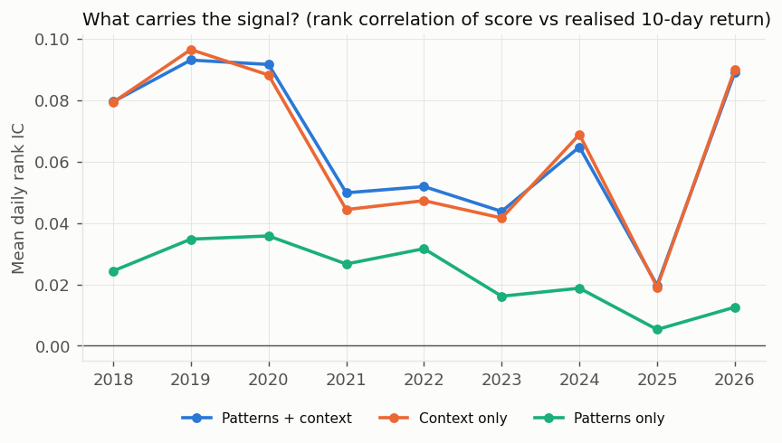

<h1 align="center">
    Chart-Pattern-Detector
</h1>

Every open-source chart-pattern model in one app, tested honestly on Indian market data, plus **TradePlan**: pick an NSE stock or upload a chart screenshot and get entry, stop, target, probability and the reasons, all backed by a real out-of-sample track record.



## What we built

1. **One app** (`streamlit run app.py`): pick a repo, pick any NSE stock or index (or upload a CSV or chart image), and see its detections or forecast on a TradingView Lightweight Chart. If a model gave a buy signal in the last N bars, the chart shows a paper trade for it: entry, stop, target, and how it has done since.
2. **One fair benchmark**: every repo is scored the same way on NSE data, 2018 → 2026. The signal is known at the close, you enter at the next open and exit 10 bars later, and the result is measured against simply holding the stock.
3. **PatternEdge**: 300 pattern detectors plus market context, fed to gradient boosting and validated walk-forward.
4. **ChartCNN**: a chart-image model that *predicts* instead of detecting (Jiang, Kelly & Xiu 2023), trained on NSE charts.
5. **TradePlan**: PatternEdge + ChartCNN turned into a trade plan, for an NSE stock or for any chart screenshot.



## The repos

| Repo | Type | Fix we applied |
|---|---|---|
| [ta_patterns](https://github.com/AdventuresInDataScience/ta_patterns) | 300 candle + chart rules | none needed (no lookahead) |
| [stock-pattern](https://github.com/BennyThadikaran/stock-pattern) | pivot geometry (H&S, triangles, harmonics) | pivots masked until confirmed (+5 bars) |
| [chart_patterns](https://github.com/zeta-zetra/chart_patterns) | pivots + regression | signals delayed 3–10 bars (repo peeks ahead) |
| [TradingPatternScanner](https://github.com/white07S/TradingPatternScanner) | rolling masks | signals delayed 1 bar |
| [HarmonicPattern](https://github.com/xxwikkixx/HarmonicPattern) | Gartley / Bat / Crab / Butterfly | run on prefixes only |
| [pytrendline](https://github.com/ednunezg/pytrendline) | trendlines | visual only |
| [foduucom YOLOv8](https://github.com/foduucom/Stockmarket-pattern-detection) | image detector | only boxes at the chart's right edge count |
| [ChartScanAI](https://github.com/Omar-Karimov/ChartScanAI) | image Buy/Sell detector | same |
| [Kronos](https://github.com/shiyu-coder/Kronos) | OHLCV foundation model | sample paths → quantiles |
| [Chronos](https://github.com/amazon-science/chronos-forecasting) | time-series foundation model | — |
| [TimesFM](https://github.com/google-research/timesfm) | time-series foundation model | — |
| [big-data-stock-price-forecast](https://github.com/nsarang/big-data-stock-price-forecast) | VAE + nearest past windows | no matching on overlapping windows |
| [TimeSeries2DBarChartImageCNN](https://github.com/omerbsezer/TimeSeries2DBarChartImageCNN) | CNN on bar images | not runnable (no weights) |
| [OHLC_Candlestick_Patterns](https://github.com/przemyslawbak/OHLC_Candlestick_Patterns) | C# rules | not runnable (.NET); covered by ta_patterns |

## TradePlan: from detecting to predicting

**Why it was needed.** ChartScanAI, foduucom and similar tools *detect*. Their training boxes were drawn by people who already knew what happened next, so on the newest candle they almost never fire, and when they do they're wrong. We tested ChartScanAI at the right edge: a 33–44% hit rate and negative returns. Paid tools like BullGPT return entry, stop and target from a screenshot, but publish no track record. Research on vision AI models reading candlestick charts finds them at 49–53%, close to a coin flip ([Hu et al. 2026](https://arxiv.org/abs/2604.12659)).

**What we built instead.** Every number below is learned from what happened *after* the chart and tested on years the model never saw.

| Piece | How it works |
|---|---|
| **ChartCNN** | 20-day black-and-white chart images (OHLC bars, 20-day average, volume), as in [Jiang, Kelly & Xiu 2023](https://doi.org/10.1111/jofi.13268). The label is "did this stock beat the day's average NSE500 stock over the next 10 days?". Trained on 2005–2010 only, then tested 2013–2026: **51.8% accuracy, rank IC 0.031**. The paper found US-trained models fail in India, so this one is trained locally. |
| **Trade levels** | Entry at the next open, stop 1.5 ATR below, target 2.5 ATR above, exit after 10 bars otherwise. Labels use this exact triple-barrier rule (López de Prado); if both levels are touched on the same bar, it counts as a stop. |
| **Models** | Gradient boosting on context, the 300 pattern events and ChartCNN, predicting both P(target before stop) and expected R. Costs of 0.3% per trade (STT, charges, slippage) are charged in R for each stock. |
| **Honest numbers** | Stocks are ranked each day. The probability and expected R shown in the app are what plans of the *same rank* actually earned in 2018–2026, because the raw model was about 0.1 R too optimistic. Only ranks whose history beats costs get **BUY**; everything else is **NO TRADE**. |
| **Screenshot path** | A colour-based candle reader pulls OHLC and volume out of a TradingView or broker screenshot; on test renders it matches the real candles at 0.9999 correlation. A separate model uses only what a picture can show (shapes in ATR units plus ChartCNN), and the plan lines are drawn on your image. |
| **Why** | Each input is swapped for a typical value to see how much it pushed the plan, plus a per-day map of which candles drove the CNN. |



| Rule, 2018 → 2026 out of sample (≈920k stock-days) | Win rate | Avg R after costs | Positive years |
|---|---:|---:|---:|
| Buy every stock | 22.9% | −0.029 | 3/9 |
| TradePlan, NSE stock: 5 best per day | 27.0% | **+0.069** | **6/9** |
| TradePlan, screenshot only: 5 best per day | 26.2% | +0.039 | 4/9 |

**Honest read:**
- **There is an edge, but it's small:** about +0.07 R per trade, roughly +0.4% after costs on a typical NSE500 stock.
- **It loses in falling-market years** (2018, 2019, 2025). Size positions small.
- **The CNN adds almost nothing on top of PatternEdge:** +0.069 R with it vs +0.068 R without. As the paper found, it mostly learns short-term reversal, which the context already captures.
- **The CNN is what makes screenshot plans possible,** because a picture carries no market context.
- **Other timeframes are untested:** the screenshot model is trained on daily NSE bars, so 1-minute charts are an extrapolation.



**Paper trading:** each evening, open the Trade plan tab and take the BUY rows (the top 5) at the next open, with the stop and target shown. Exit after 10 bars if neither level is hit. Compare your results with the history table in the app.

## Results



- **Raw patterns are noise on Indian large caps.** No rule-based or YOLO repo beats holding the stock once its lookahead is removed.
- **The forecasters (Chronos, TimesFM) predict mostly drift**, so their directional edge is small and not statistically significant.
- **Kronos is the most promising forecaster.** Over 1,004 forecasts its rank IC is 0.18, but the result is not yet significant (t ≈ 0.9).
- **PatternEdge earns +61 bps per 10-day signal on NSE500** (+51 bps for longs only), with t ≈ 19.





**The honest part:**
- Most of PatternEdge's edge comes from market context: trend, regime and breadth.
- Patterns alone are weak and have been decaying since 2023.
- The edge is in mid and small caps; on Nifty 50 it's noise.
- The universe is today's NSE500, so stocks that dropped out are missing (survivorship bias).

## Run

```bash
uv venv .venv --python 3.10 && source .venv/bin/activate
uv pip install torch --index-url https://download.pytorch.org/whl/cpu && uv pip install -r requirements.txt
scripts/setup_vendor.sh      # clones the repos above at tested commits
python scripts/get_data.py   # NSE daily data + trained models (~70 MB), no training needed
streamlit run app.py
```

The [`data` release](https://github.com/MananPoojara/chart-pattern-detector/releases/tag/data) is rebuilt every trading night:
- **Data:** NSE500 stocks, 5 NSE indices and breadth, as Parquet/CSV. New days come from NSE's official bhavcopy and index files. Splits and bonuses are back-adjusted from NSE's adjusted previous close, and symbol renames are followed by ISIN.
- **Models:** retrained, with today's plans.

**Live intraday (Angel One):** put `ANGEL_ONE_API_KEY`, `ANGEL_ONE_CLIENT_CODE`, `ANGEL_ONE_MPIN` and `ANGEL_ONE_TOTP_SECRET` in `.env`, which is gitignored. Then run `python scripts/live_scan.py`.
- It streams ticks from SmartStream, builds 5-minute bars, and runs ChartScanAI on each finished bar.
- New signals go to a CSV, with stop and target levels.
- In the app, choose "Live intraday (Angel One)". The chart refreshes every minute.
- The candle-history API throttles hard (403 "exceeding access rate" well below its documented limits), so it is called only once per symbol for context, never every bar.

To use your own data, set `CPD_STOCK_ROOT` (index.csv + `daily/*.csv` or `bars.parquet`), `CPD_INDEX_CSV` and `CPD_BREADTH_CSV`. To update it, run `python scripts/update_data.py --out <dir>`.

Reproduce:
1. **Benchmark:** `scripts/run_bench.sh <method>…`, then `python -m cpd.bench report`.
2. **PatternEdge:** `python -m cpd.edge build && python -m cpd.edge fit`.
3. **ChartCNN:** `python -m cpd.chartcnn build && python -m cpd.chartcnn train && python -m cpd.chartcnn predict`.
4. **TradePlan:** `python -m cpd.tradeplan fit [--no-cnn | --image]`, then `python -m cpd.tradeplan final [--image]`.
5. **Figures:** `python scripts/make_figures.py`.

```
app.py           UI
cpd/rules.py     rule-based adapters      cpd/vision.py    YOLO adapters
cpd/forecast.py  forecaster adapters      cpd/edge.py      PatternEdge
cpd/bench.py     benchmark                cpd/evaluate.py  scoring
cpd/chartcnn.py  chart-image CNN          cpd/tradeplan.py entry/stop/target models + backtest
cpd/digitize.py  screenshot -> candles    cpd/plan_ui.py   Trade plan tab
cpd/lwchart.py   Lightweight Charts + paper-trade levels
scripts/update_data.py  NSE daily update   scripts/get_data.py / publish_data.py  release download / upload
```

Market data is never committed. Upstream repos are cloned at runtime and keep their own licences. Nothing here is investment advice: it's a research tool with its track record attached.
